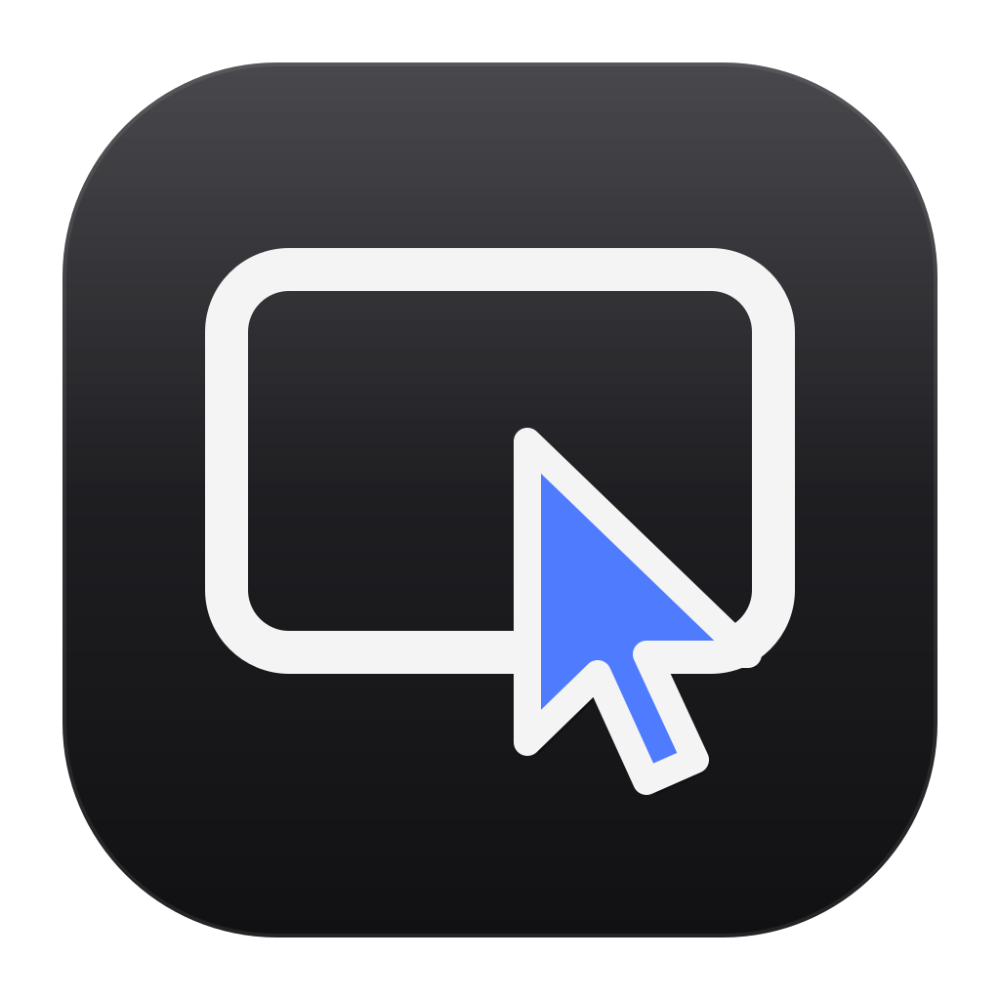
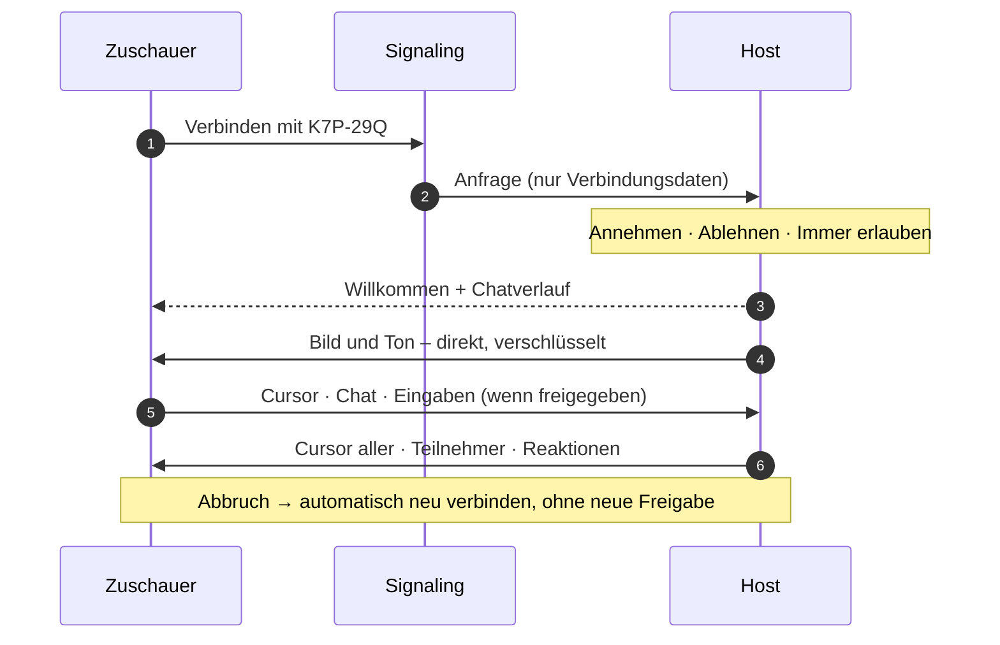
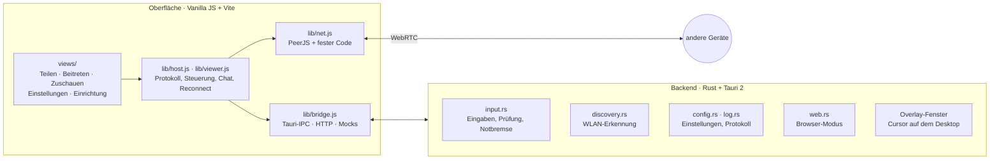

<div align="center">



# Screen-Clean

**Gemeinsam an einem Bildschirm.**<br/>
Bildschirm teilen und gemeinsam steuern – direkt von Gerät zu Gerät. Ohne Konto, ohne Cloud.

[](../../releases/latest)
[](LICENSE)
[](#installieren)
[](#installieren)
[](#aufbau)

[Website](https://emre1001.github.io/Screen-Clean/) · [Herunterladen](../../releases/latest) · [Funktionen](#funktionen) · [So funktioniert’s](#so-funktionierts) · [Fragen](#häufige-fragen)

<br/>

<picture>
  <source media="(prefers-color-scheme: dark)" srcset="docs/hero-dark.svg" />
  
</picture>

</div>

> [!TIP]
> **Neu in 0.1.1:** Deutsch, English und Türkçe · Updates direkt in der App · flüssigere Cursor · beim Steuern nur noch dein Mauszeiger plus Fadenkreuz · unter Linux das richtige Icon in der Taskleiste. Alle Änderungen stehen in den [Releases](../../releases).

## Funktionen

<table>
<tr>
<td width="33%" valign="top">

**Direkt verbunden**<br/>
WebRTC von Gerät zu Gerät, bis 120 FPS. H.264 mit Hardware-Encoder, VP8, VP9 oder AV1 – mit Systemton.

</td>
<td width="33%" valign="top">

**Jeder Cursor hat einen Namen**<br/>
Alle sehen, wohin die anderen zeigen – in ihrer Farbe. Beim Teilen liegen die Cursor als Overlay auf deinem Desktop, auch wenn die App minimiert ist.

</td>
<td width="33%" valign="top">

**Steuern, nur wenn du willst**<br/>
Maus, Tastatur, Shortcuts und AltGr-Zeichen. Jede Anfrage landet bei dir, ein Klick nimmt die Steuerung zurück.

</td>
</tr>
<tr>
<td valign="top">

**Chat und Reaktionen**<br/>
Nachrichten mit klickbaren Links, Emoji-Reaktionen über dem Bild. Wer später dazukommt, sieht den Verlauf.

</td>
<td valign="top">

**Abbruch? Geht weiter.**<br/>
Reißt die Verbindung ab, verbindet Screen-Clean von selbst neu – ohne dass du erneut freigeben musst.

</td>
<td valign="top">

**Ein Code. Für immer.**<br/>
Feste sechs Zeichen pro Installation. Freunde speichern, als vertraut markieren, im WLAN automatisch finden.

</td>
</tr>
</table>

Dazu: Deutsch, English und Türkçe, Updates direkt in der App, Einrichtung in sechs Schritten mit System-Check, Hell- und Dunkelmodus nach System, Live-Diagnose (FPS, Bitrate, Ping, Verbindungsweg), Tray, Autostart und eine Notbremse auf <kbd>Strg</kbd> <kbd>Shift</kbd> <kbd>X</kbd>.

## Installieren

<details open>
<summary><b>Windows</b></summary>
<br/>

`Screen-Clean_…_x64-setup.exe` aus den [Releases](../../releases/latest) laden und starten – die Einrichtung führt durch den Rest. WebView2 ist auf Windows 10 und 11 vorinstalliert. Neue Versionen installiert die App danach selbst.
</details>

<details>
<summary><b>Linux</b></summary>
<br/>

`.deb` oder `.AppImage` aus den [Releases](../../releases/latest). Die **AppImage** aktualisiert sich selbst; beim `.deb` lädst du neue Versionen von Hand.

> [!NOTE]
> Viele Distributionen (z. B. Ubuntu) liefern WebKitGTK ohne WebRTC aus. Screen-Clean erkennt das und öffnet die Oberfläche dann als App-Fenster in Chrome, Chromium, Brave oder Edge – sonst im Standard-Browser. Tray, Tastenkürzel, Fernsteuerung, WLAN-Erkennung und Cursor-Overlay laufen weiter über die App.

Die Fernsteuerung braucht eine X11-Sitzung. Unter Wayland erreicht sie nur XWayland-Programme – der System-Check zeigt das an.

Nach einer Neuinstallation einmal über das Tray-Symbol **Beenden** und neu starten – sonst läuft im Hintergrund noch die alte Version weiter.
</details>

<details>
<summary><b>Aus dem Quellcode</b></summary>
<br/>

Voraussetzungen: [Rust](https://rustup.rs) und [Node.js](https://nodejs.org) 18 oder neuer. Unter Windows die MSVC Build Tools, unter Linux `libwebkit2gtk-4.1-dev libayatana-appindicator3-dev librsvg2-dev libxdo-dev`.

```bash
git clone https://github.com/Emre1001/Screen-Clean.git
cd Screen-Clean
npm install
npm run tauri dev
```

Installer bauen – das Ergebnis liegt unter `src-tauri/target/release/bundle/`:

```bash
npm run tauri build
```
</details>

## So funktioniert’s



Der Signaling-Server vermittelt nur den Verbindungsaufbau. Bild, Ton, Chat und Eingaben gehen direkt zwischen den Geräten und sind per DTLS-SRTP verschlüsselt. Hinter strengen NATs springt ein TURN-Relay ein – die Live-Diagnose zeigt, welcher Weg genutzt wird.

| Teilen | Beitreten |
|---|---|
| App öffnen – dein Code steht unter **Teilen**. | Unter **Beitreten** den Code eintippen oder einfügen. |
| **Bildschirm teilen** und einen Monitor wählen. | Warten, bis der Host annimmt. Vertraute Freunde sind sofort drin. |
| Anfragen annehmen – **Immer erlauben** merkt sich die Person. | **Steuern** anfragen, wenn du mitarbeiten willst. |
| Bei **Personen** Steuerung geben, zurücknehmen oder jemanden entfernen. | Chat, Reaktionen, Diagnose und Vollbild im Dock unten. |

> [!TIP]
> Fernsteuerung und Cursor-Overlay brauchen einen geteilten **ganzen Bildschirm**. Bei mehreren Monitoren erkennt Screen-Clean den richtigen an der Auflösung – oder du legst ihn unter *Einstellungen → Steuerung* fest.

| Tastenkürzel | Wirkung |
|---|---|
| <kbd>Alt</kbd> <kbd>Shift</kbd> <kbd>S</kbd> | App zeigen oder verstecken – systemweit |
| <kbd>Strg</kbd> <kbd>Shift</kbd> <kbd>X</kbd> | Notbremse: Steuerung entziehen, Teilen beenden – systemweit |
| <kbd>Esc</kbd> | Vollbild verlassen |

## Sicherheit

- **Du entscheidest.** Beitritt und Steuerung stehen standardmäßig auf *Fragen*. „Vertraut“ erlaubt nur das Zuschauen ohne Nachfrage.
- **Eingaben werden geprüft.** Nur der freigegebene Zuschauer darf steuern. Jede Eingabe wird im Rust-Backend gegen eine Allowlist geprüft, bevor sie das System erreicht.
- **Die Notbremse greift immer.** Sie sperrt Eingaben direkt im Backend, auch wenn die Oberfläche hängt. Wer gerade steuert, steht als Banner auf deinem Bildschirm.
- **Keine Server von uns.** Kein Konto, kein Tracking. Den Signaling-Server kannst du selbst betreiben.
- **Updates sind signiert.** Die App installiert nur Pakete, deren Signatur zum eingebauten Schlüssel passt.
- **Browser-Modus abgesichert.** Nur `127.0.0.1`, zufälliger Port, Einmal-Token in der URL, fremde Webseiten werden abgewiesen.

## Aufbau



<details>
<summary><b>Dateien</b></summary>
<br/>

```
src/
├── main.js            Start, Navigation, Anfragen, globale Ereignisse
├── overlay.js         Cursor-Overlay des Hosts
├── lib/               net · host · viewer · quality · stats · lan · bridge · store · ui
├── views/             share · join · session · settings · setup · chat · controls
└── styles/            tokens · app · cursor · overlay
src-tauri/src/
├── lib.rs             Tray, Tastenkürzel, Overlay, Fenster, Befehle
├── input.rs           Eingabe-Thread mit enigo, Prüfung, Zusammenfassen von Mausbewegungen
├── discovery.rs       UDP-Beacon auf Port 47821
├── config.rs          Einstellungen als JSON, atomar gespeichert
├── log.rs             Protokolldatei mit Rotation
├── update.rs          In-App-Updates aus GitHub Releases (signiert)
└── web.rs             lokaler Server für den Browser-Modus
src/locales/           Deutsch, English, Türkçe
scripts/latest-json.mjs  Update-Manifest aus den signierten Builds
website/               Projektseite (GitHub Pages)
```
</details>

## Häufige Fragen

<details>
<summary><b>Brauche ich ein Konto? Kostet das etwas?</b></summary>
<br/>

Nein. Screen-Clean ist kostenlos und Open Source (MIT).
</details>

<details>
<summary><b>Wie viele Leute können zuschauen?</b></summary>
<br/>

Beliebig viele – jeder bekommt einen eigenen Stream. Praktisch begrenzt der Upload des Hosts. Für größere Runden die Qualität *Sparsam* wählen.
</details>

<details>
<summary><b>Geht das auch übers Internet?</b></summary>
<br/>

Ja. Die WLAN-Erkennung ist nur eine Abkürzung – mit dem Code klappt es weltweit.
</details>

<details>
<summary><b>Schwarzes Bild oder Grafikfehler?</b></summary>
<br/>

*Einstellungen → Netzwerk → Kompatibilitäts-Modus* startet die Oberfläche ohne GPU neu.
</details>

<details>
<summary><b>Verbindung kommt nicht zustande?</b></summary>
<br/>

Die Firewall blockiert vermutlich WebRTC. Screen-Clean (unter Windows auch `msedgewebview2.exe`) freigeben. Für die WLAN-Erkennung UDP-Port 47821 erlauben.
</details>

<details>
<summary><b>Kann ich einen eigenen Signaling-Server nutzen?</b></summary>
<br/>

Ja: einen [PeerJS-Server](https://github.com/peers/peerjs-server) starten und unter *Einstellungen → Netzwerk* eintragen. Alle Beteiligten brauchen denselben Server.
</details>

## Pläne

- [ ] Dateien per Drag & Drop senden
- [ ] Zwischenablage teilen
- [ ] Auf dem Bild zeichnen
- [ ] macOS

## Mitmachen

Pull Requests sind willkommen – für größere Änderungen bitte zuerst ein Issue öffnen.

```bash
npm test                      # Oberfläche
cd src-tauri && cargo test    # Backend
npm run website               # Website lokal (http://localhost:4173)
```

<details>
<summary><b>Neue Version veröffentlichen</b></summary>
<br/>

1. Version in `package.json`, `src-tauri/tauri.conf.json` und `src-tauri/Cargo.toml` erhöhen.
2. Commit, dann Tag pushen: `git tag v0.1.2 && git push origin v0.1.2`.
3. Der Workflow *Release* baut `.exe`, `.deb`, `.AppImage`, die Signaturen und `latest.json` (Secret `TAURI_SIGNING_PRIVATE_KEY` muss gesetzt sein).
4. Artefakte laden und als Release veröffentlichen – kein Entwurf, sonst findet die App das Update nicht:

```bash
gh run download <run-id> --dir art
gh release create v0.1.2 art/*/*/*.exe art/*/*/*.exe.sig art/*/*/*.deb art/*/*/*.AppImage art/*/*/*.AppImage.sig art/latest-json/latest.json
```
</details>

Mit `npm run dev` läuft die Oberfläche auch im normalen Browser. Zwei Tabs auf `localhost:1420` und `127.0.0.1:1420` reichen, um Verbindung, Chat und Stream auszuprobieren.

## Lizenz

[MIT](LICENSE) © Emre
